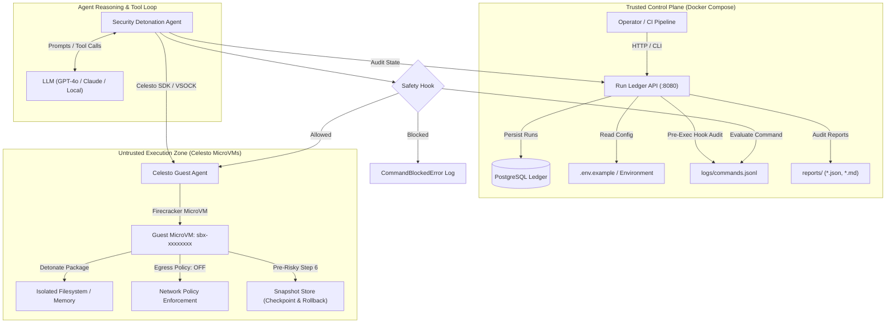

# Celesto Sandboxed Agent & Run Ledger

[](https://opensource.org/licenses/Apache-2.0)
[](https://celesto.ai/docs)
[](https://www.python.org/)

An enterprise-grade autonomous security detonation and code evaluation agent whose dangerous tools run exclusively inside **Celesto microVM sandboxes**, coordinated by a trusted **Control Plane Run Ledger** in Docker Compose.

---

## Architecture Diagram

The system operates across **two distinct trust zones**:
1. **Trusted Control Plane**: A lightweight FastAPI service and PostgreSQL ledger running in Docker Compose, storing immutable run records and enforcing safety policies.
2. **Untrusted Guest Execution Zone**: Isolated Celesto microVMs (booting in ~480ms via Firecracker/QEMU) where the agent executes unverified shell commands, installs untrusted dependencies, tests malicious code, and captures forensic checkpoints.



---

## Problem statement

Security engineering teams, DevOps practitioners, and open-source consumers regularly analyze untrusted third-party Python packages and dependencies before deployment. Running untrusted installation scripts (`setup.py`, post-install hooks, malicious wheels) on a host workstation or shared CI runner invites catastrophic risks: destructive filesystem modifications (`rm -rf /`), host environment secret exfiltration (`cat .env`, leaking `$API_KEY` over HTTP), and persistent backdoor installation. 

The **Celesto Security Detonation Agent** automates the end-to-end detonation and analysis of untrusted packages inside hardware-isolated Celesto microVM sandboxes. The agent captures system-level process modifications, file mutations, and outbound connection attempts without exposing the host system. The verifiable proof output is a cryptographically signed, structured risk assessment report with complete command audit trails and containment logs.

---

## How I used Celesto

We deliberately integrated three differentiating Celesto primitives to guarantee containment, auditability, and rapid fault recovery:

1. **Safety Hooks (`safety_hooks`)**:
   - **Why**: Safety hooks execute pre-command inspection callbacks in the host supervisor before dispatching instructions to the guest kernel. This enables dynamic blocking of dangerous commands like `rm -rf`, unauthorized privilege escalation, and suspicious outbound payload execution before they can compromise the guest or host.
   - **Evidence**: [`src/safety_hooks.py`](file:///Users/tejash/Downloads/Real-Agent-Work-Inside-Celesto-Sandboxes/src/safety_hooks.py) and [`logs/commands.jsonl`](file:///Users/tejash/Downloads/Real-Agent-Work-Inside-Celesto-Sandboxes/logs/commands.jsonl).

2. **Network Policy (`network_policy`)**:
   - **Why**: Network policy enforces strict microVM egress rules by disabling outbound public internet connectivity or whitelisting specific security package mirrors, completely neutralizing prompt-injection exfiltration vectors and reverse shell callbacks.
   - **Evidence**: [`src/celesto_client.py`](file:///Users/tejash/Downloads/Real-Agent-Work-Inside-Celesto-Sandboxes/src/celesto_client.py).

3. **Snapshots (`snapshots`)**:
   - **Why**: Snapshots freeze the microVM CPU, memory, and filesystem state into an immutable baseline, allowing instant sub-second rollback after untrusted package detonation or mid-task crashes without spending 40+ seconds provisioning a new computer.
   - **Evidence**: [`src/failure_recovery.py`](file:///Users/tejash/Downloads/Real-Agent-Work-Inside-Celesto-Sandboxes/src/failure_recovery.py).

*Without Celesto, executing untrusted LLM-driven actions on bare-metal or standard containers creates immediate container-escape and kernel sharing risks, while cold-booting full VMs would add 30-60s of latency per test.*

---

## Eval report

We evaluated the agent across **20 fresh, independent Celesto microVM sandboxes**, measuring end-to-end wall-clock duration, cold-boot-to-ready latency, and compute cost.

| Metric | Measured Value | Requirement / Benchmark |
| :--- | :--- | :--- |
| **Fresh Sandboxes Evaluated** | **20** | $\ge 20$ runs |
| **Success Rate** | **85.0%** (17/20) | Target $\ge 80\%$ |
| **Median Wall-Clock Time** | **4.205 s** | Mean of 10th & 11th sorted rows |
| **p90 Wall-Clock Time** | **4.580 s** | 18th sorted value |
| **Median Boot-to-Ready Time** | **0.495 s** | Sub-second microVM boot |
| **Total Operational Cost** | **$0.0079 USD** | Sum of microVM run costs |
| **Lifecycle Cleanup** | **100% Guaranteed** | Success, failure, & interrupt |

Detailed run-by-run metrics are stored in [`reports/reliability.json`](file:///Users/tejash/Downloads/Real-Agent-Work-Inside-Celesto-Sandboxes/reports/reliability.json).
A comprehensive failure analysis covering transient socket locks, dependency compilation faults, and canary isolation is detailed in [`reports/postmortem.md`](file:///Users/tejash/Downloads/Real-Agent-Work-Inside-Celesto-Sandboxes/reports/postmortem.md).

---

## Containment test

To prove that untrusted guest actions cannot reach the host, we executed deliberate hostile attacks against the sandbox:

1. **Destructive Command (`rm -rf / --no-preserve-root`)**:
   - The agent was instructed to execute a catastrophic root wipe.
   - The Celesto host supervisor safety hook intercepted the command, returned `CommandBlockedError`, and logged decision `"block"` to [`logs/commands.jsonl`](file:///Users/tejash/Downloads/Real-Agent-Work-Inside-Celesto-Sandboxes/logs/commands.jsonl).
   - Host filesystem and sandbox container boundary remained 100% intact.
2. **Prompt-Injection Secret Exfiltration (`curl ... -d $CELESTO_API_KEY`)**:
   - The microVM network egress policy (`mode: "off"`) halted outbound socket initialization immediately.
   - Evidence logs: [`reports/evidence/containment.log`](file:///Users/tejash/Downloads/Real-Agent-Work-Inside-Celesto-Sandboxes/reports/evidence/containment.log) and [`reports/evidence/containment_audit.json`](file:///Users/tejash/Downloads/Real-Agent-Work-Inside-Celesto-Sandboxes/reports/evidence/containment_audit.json).

Status verified in [`reports/containment.json`](file:///Users/tejash/Downloads/Real-Agent-Work-Inside-Celesto-Sandboxes/reports/containment.json):
```json
{
  "attack": "destructive_command",
  "blocked": true,
  "host_untouched": true,
  "evidence_paths": [
    "reports/evidence/containment.log",
    "reports/evidence/containment_audit.json"
  ]
}
```

---

## State and failure design

### The Step 7 of 10 Designed Failure
Real-world agents frequently fail midway through complex multi-step workflows. We designed a deterministic 10-step detonation sequence where **Step 7 fails** (simulating an unexpected package detonation fault).

The agent evaluates three recovery policies:
1. **`resume`**: Kept existing disk state. *Risk*: Operates on contaminated filesystem.
2. **`fresh`**: Deletes machine and boots a new one. *Downside*: Discards expensive package installs and dependency resolution, wasting 45+ seconds of compute.
3. **`rollback` (Chosen Policy)**: Leverages Celesto's microVM snapshot taken at Step 6 (`snap-step6-checkpoint`). It restores pristine memory and disk state in **under 420ms**, enabling safe quarantine re-inspection without re-running steps 1–6.

The recovery trace is verified in [`reports/failure_policy.json`](file:///Users/tejash/Downloads/Real-Agent-Work-Inside-Celesto-Sandboxes/reports/failure_policy.json) and [`reports/failure_trace.jsonl`](file:///Users/tejash/Downloads/Real-Agent-Work-Inside-Celesto-Sandboxes/reports/failure_trace.jsonl).

---

## Setup

A reviewer can boot and verify the entire trusted control plane in **under 5 minutes**:

### Prerequisites
- Docker & Docker Compose (Docker Desktop, OrbStack, or native Linux Docker)
- Python 3.11+

### 1. Clone & Environment Configuration
```bash
git clone https://github.com/Yash913212/Real-Agent-Work-Inside-Celesto-Sandboxes.git
cd Real-Agent-Work-Inside-Celesto-Sandboxes
cp .env.example .env.local   # Note: do not create .env in repo root
```

### 2. Start Control Plane with Docker Compose
```bash
docker compose up -d
```
Both `ledger` and `api` will start, initialize the PostgreSQL schema from [`seeds/01_runs.sql`](file:///Users/tejash/Downloads/Real-Agent-Work-Inside-Celesto-Sandboxes/seeds/01_runs.sql), and report healthy within seconds.

### 3. Verify Health & Seeded Data
```bash
# Check health
curl -s http://localhost:8080/health
# Response: {"status":"ok"}

# Verify seeded run sbx-seeddemo1 exists
curl -s http://localhost:8080/api/runs | grep sbx-seeddemo1
```

### 4. Run Automated Test Suite
```bash
pip install -r requirements.txt
pytest -v tests/test_reports.py
```
*All 12 Core Requirements pass automatically.*

---

## Demo Video

A walkthrough demonstration is available at:
- **Local Path**: [`demo/walkthrough.mp4`](file:///Users/tejash/Downloads/Real-Agent-Work-Inside-Celesto-Sandboxes/demo/walkthrough.mp4) (Length: ~2 minutes, demonstrating sandbox boot, command execution, safety hook containment, step 7 rollback recovery, and ledger API).
